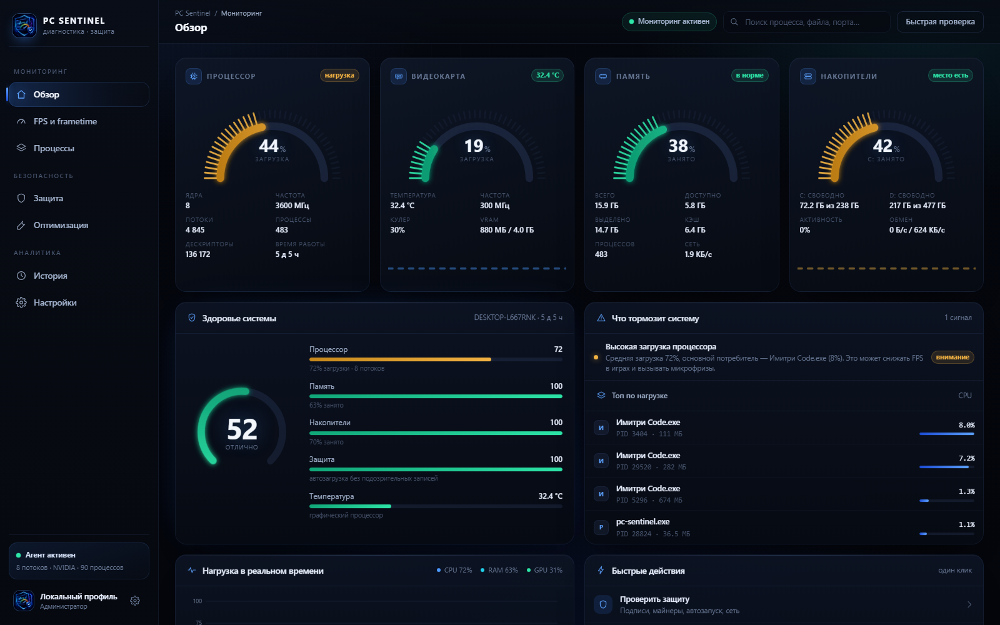
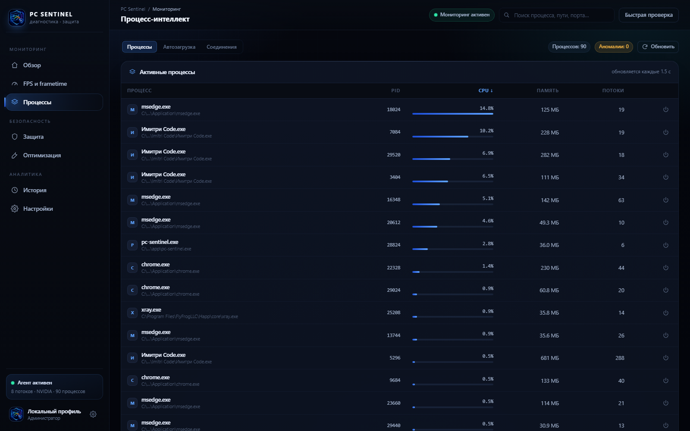
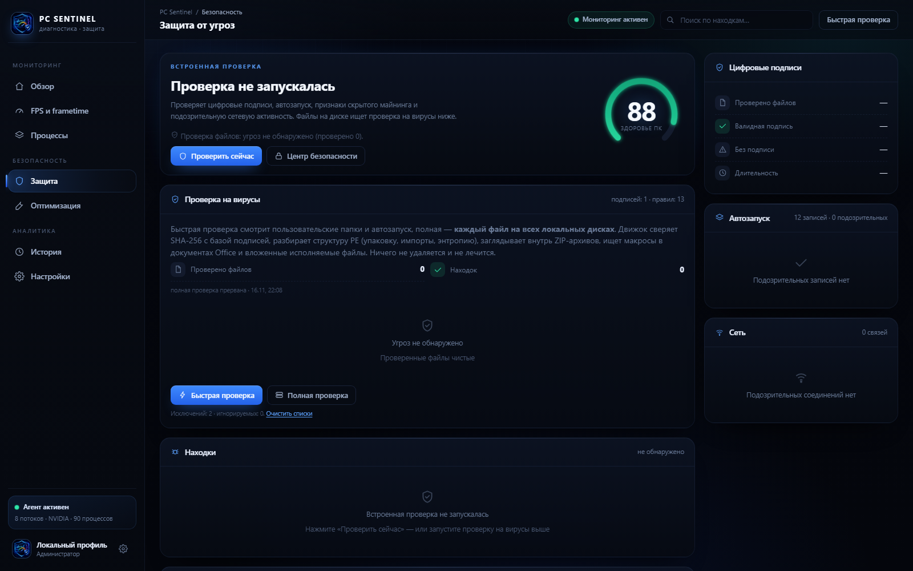
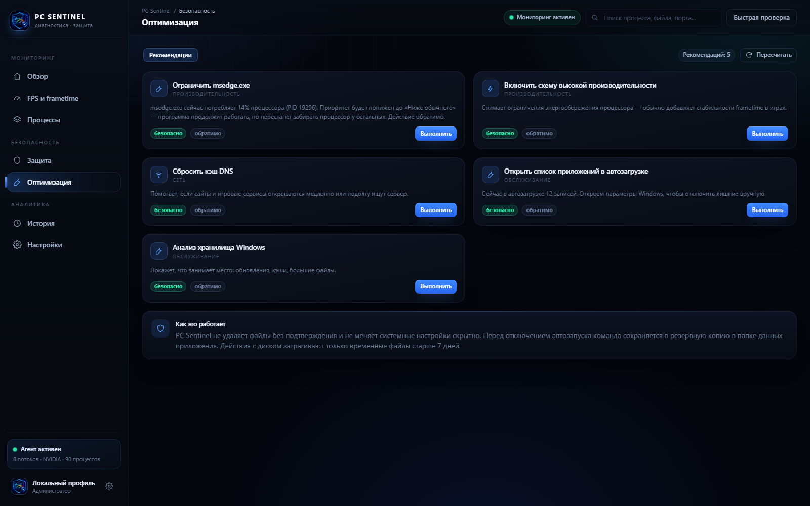
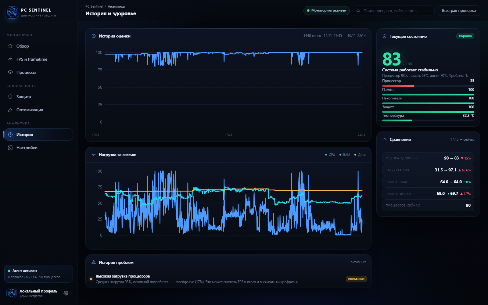

# PC Sentinel

**Windows PC diagnostics, optimization and a built-in antivirus engine — fully local, no cloud, no telemetry.**

PC Sentinel explains *why* a computer is slow: which process eats the CPU, what limits FPS,
which files look suspicious. It is not a wrapper around someone else's antivirus — the scan
engine, the PE parser, the archive reader and the UI are all written from scratch.

[Русская версия](README.ru.md)



---

## Why this project exists

Most "PC optimizer" tools show numbers and offer a big green button. This one tries to answer
three questions honestly:

1. **What is actually happening?** — real Win32 telemetry, not estimates.
2. **Why?** — every finding has a reason, not just a red badge.
3. **What will it cost me?** — every action states its risk and whether it is reversible.

If a value cannot be measured, the UI shows a dash instead of a fake number. If the agent is
not running, screens show an empty state instead of zeros. "No data" is never presented as
"all clean".

---

## Screenshots

| Processes | Security & antivirus |
|---|---|
|  |  |

| Optimization | History |
|---|---|
|  |  |

---

## Architecture

Two parts, no frameworks, no runtime dependencies.

| Part | Stack | Role |
|---|---|---|
| **Agent** (`agent/`) | Rust, **std only** + Win32 FFI | Collects telemetry, parses PE files, scans the disk, serves JSON over `127.0.0.1` |
| **UI** (`src/`) | TypeScript (strict), own SVG chart layer, CSS design system | Seven screens in a single dark theme |

```
TypeScript UI  →  HTTP (localhost)  →  Rust agent  →  Win32 API  →  JSON  →  SVG/DOM
```

The window is Edge in `--app` mode (WebView2) — no address bar, no tabs. The agent listens on
`127.0.0.1` only and rejects requests with a foreign `Origin` header, so a random web page
cannot drive it through localhost.

### Why Rust and not C++

The agent is compiled with the GNU toolchain and links with `rust-lld`; there is no MSVC in the
build environment. Rust gives the same native code with memory safety, and the whole agent has
**zero external crates** — the build is deterministic and reproducible.

---

## The antivirus engine

This is the part that took the most work. It is a real static analysis engine, not a list of
file names.

### What it looks at

| Layer | What it does |
|---|---|
| **SHA-256 signatures** | Exact hash match against `signatures.txt` (extendable without rebuilding) |
| **PE parsing** | Sections, entropy, import table, packers, overlay, TLS callbacks, entry point, build timestamp |
| **API combinations** | Code injection, keylogging, file encryption, droppers — from `heuristics.txt` |
| **YARA-style rules** | Text and hex patterns with `??` wildcards, `any`/`all` conditions (`yara.txt`) |
| **ZIP archives** | Own inflate, every entry scanned with the same rules, nested archives, zip-bomb limits |
| **Office documents** | VBA macro that calls the shell — the classic attachment attack |
| **Embedded PE** | An executable hidden inside another file, found by header structure, not by `MZ` bytes |
| **Type by signature** | A program named `notes.txt` is still a program |
| **Authenticode** | `WinVerifyTrust` plus **catalog** signatures for system files |

### Findings are a sum of evidence, not a single hit

Every structural signal also occurs in perfectly normal software: packed installers, API-set
stubs with no import table, `/Brepro` builds whose "timestamp" is a hash, TLS callbacks in the
C++ runtime. So signals carry weights and only their **sum** decides:

```
WEAK = 1   MEDIUM = 2   STRONG = 6   THRESHOLD = 6
```

The contribution of weak signals is capped, so ten coincidences never add up to a verdict.
A file with a **valid publisher signature** is not reported for structure or imports —
`kernel32.dll` can write into another process too, but it is not a virus. A hash match is
checked earlier and stays a finding even if the file is signed.

### Scan modes

- **Quick** — running process files, `System32`/`SysWOW64`, `Program Files`, `ProgramData`,
  user folders, temp, autostart. The same areas a commercial antivirus covers first.
- **Full** — **every file** on every local drive, not just executables.

Progress is shown as a percentage: objects are counted before the scan starts, so the bar
actually means something.

### Scan cache

An unchanged file that was clean last time is not read again — the key is path + size +
modification time (the same idea as iSwift). A repeat scan of 17 000 files takes seconds.

### What it deliberately does not do

- **No cloud reputation.** There is no KSN equivalent; that needs servers.
- **No kernel driver.** Real-time protection needs one; this is an on-demand scanner.
- **No emulation.** Static analysis only — no sandbox, no behavioural tracing.
- **No removal.** It finds and explains; the user decides.

---

## Other features

### Telemetry
CPU (`GetSystemTimes`), memory (`GlobalMemoryStatusEx`), disks, network (PDH counters),
processes (`CreateToolhelp32Snapshot` + `psapi`), GPU via NVML, and GPU temperature from WDDM
counters (`D3DKMTQueryAdapterInfo`) — the same source Task Manager uses.

### Process intelligence
Live process list with CPU, memory, threads, path, PID. Anomalies: processes from user folders
with high load. Autostart from `HKLM/HKCU → Run`, `RunOnce` and Startup folders, with
suspicious entries marked. Network connections per process. Process termination with
confirmation; system processes are protected.

### FPS and frametime
Import PresentMon / CapFrameX CSV captures and get average FPS, P95/P5, 1% and 0.1% lows,
micro-stutter count and a frametime chart with outliers highlighted. Parsing happens in the
browser — the file never leaves the machine.

### Health score
0–100 across five components (CPU, memory, storage, protection, temperature) with history and
personal recommendations that explain cause and consequence.

### Optimization
Recommendations with effect and risk. Actions are reversible where possible: autostart entries
are backed up before removal, temp cleanup only touches files older than 7 days, process
priority changes report the previous class.

### Game profile
Point it at a game folder — it finds the main executable, and while the game runs it switches
to the high-performance power plan and raises the process priority. On exit everything is
restored.

---

## Install

### From a release

Download `PCSentinel-Setup.exe` and run it. It installs to `%LOCALAPPDATA%\PCSentinel\app`,
creates desktop and Start Menu shortcuts, and registers itself in *Programs and Features*.

Uninstall through Windows settings, or:

```bat
"%LOCALAPPDATA%\PCSentinel\app\pc-sentinel.exe" --uninstall
```

### From source

Requires Windows 10/11 and the Rust GNU toolchain.

```bat
build.bat     :: UI + agent + icon/version/manifest
install.bat   :: copy to LocalAppData and create shortcuts
scripts\package.bat  :: portable package in dist-package\
```

`run.bat` builds and runs without installing.

### Building the installer

The setup executable is a self-extracting archive built with `iexpress.exe`, which ships with
Windows — no Inno Setup or NSIS required:

```bat
build.bat
scripts\package.bat
cd dist-package && tar -a -c -f ..\dist\package.zip *
iexpress /N /Q dist\setup.sed
```

The result is `dist\PCSentinel-Setup.exe`: it extracts the package, stops a running instance
if needed, installs to `%LOCALAPPDATA%\PCSentinel\app`, creates shortcuts and registers the
app in *Programs and Features*.

---

## Command line

```bat
pc-sentinel.exe --no-window              :: API only, no window
pc-sentinel.exe --port 47900             :: different port
pc-sentinel.exe --diag                   :: subsystem diagnostics
pc-sentinel.exe --scan "C:\Folder"       :: scan a folder or file, findings to console
pc-sentinel.exe --scan "C:\Folder" --out report.txt
pc-sentinel.exe --pe "C:\File.exe"       :: what the engine sees: sections, imports, signals
pc-sentinel.exe --rules                  :: which rules are loaded and from where
pc-sentinel.exe --trust                  :: trusted paths to add to antivirus exclusions
pc-sentinel.exe --install                :: install
pc-sentinel.exe --uninstall              :: remove shortcuts and app folder
```

---

## Project layout

```
agent/                   native agent (Rust, std only)
  src/main.rs            HTTP routing, state, window launch
  src/http.rs            minimal server on std::net
  src/sys.rs             CPU, GPU, memory, disks, network, processes
  src/sec.rs             signatures, autostart, TCP table, SHA-256
  src/av.rs              antivirus engine: walk, findings, exclusions, evidence scoring
  src/pe.rs              PE parsing: sections, entropy, imports, packers, anomalies
  src/archive.rs         ZIP reader with zip-bomb limits
  src/inflate.rs         own deflate implementation
  src/yara.rs            YARA-style rules
  src/heur.rs            API combinations, packers, script markers
  src/fps.rs             frametime analysis
  src/health.rs          health score and recommendations
  src/optimize.rs        safe actions
  src/game.rs            game profile
  src/install.rs         install, shortcuts, Programs and Features entry
  src/store.rs           settings and history
  src/win.rs             Win32 FFI

src/                     UI (TypeScript)
  core/api.ts            agent response types and HTTP client
  core/store.ts          state, polling, routes
  core/charts.ts         SVG charts: gauges, rings, lines, histograms
  views/*.ts             seven screens
  styles/*.css           design system

rules.txt                process detection rules
signatures.txt           SHA-256 signature database
yara.txt                 YARA-style rules
heuristics.txt           API combinations, packers, script markers
```

---

## Tests

```bat
cd agent
cargo +stable-x86_64-pc-windows-gnu test
```

126 tests: JSON parsing, routing, Origin checks, HTTP layer, PE parsing (RVA mapping, import
reading, truncation), archive reading (stored, deflate, zip bombs), evidence scoring, scan
cache, game profile, optimization actions.

Tests redirect data to `%TEMP%\pc-sentinel-tests` through `PC_SENTINEL_DATA`, so real user
settings are never touched.

---

## Notes on antivirus false positives

Building a security tool with a security tool installed is awkward: Kaspersky deletes the
compiled binary because the engine contains PE parsing, archive unpacking and file walking —
a textbook dropper profile.

Two things solve it, and both are in the repo:

1. **Detection strings live in text files**, not in the binary (`rules.txt`, `yara.txt`,
   `heuristics.txt`). The engine reads them at runtime.
2. **`strip = true`** in the release profile. Without debug symbols the heuristic does not
   trigger.

If your antivirus still complains, `pc-sentinel.exe --trust` prints the exact paths to add to
its exclusions.

---

## Limitations

- **Administrator rights.** Without them, paths and signatures of some system processes are
  unavailable; the UI reports how many were skipped instead of pretending the check was full.
- **GPU metrics** are NVIDIA-only (NVML); others show "sensor unavailable".
- **Live FPS** is not captured (that needs ETW/PresentMon); the module works with imported
  captures.
- **Full scan of all drives takes hours**, like any antivirus. Repeat scans are fast thanks to
  the cache.

---

## License

[MIT](LICENSE)
